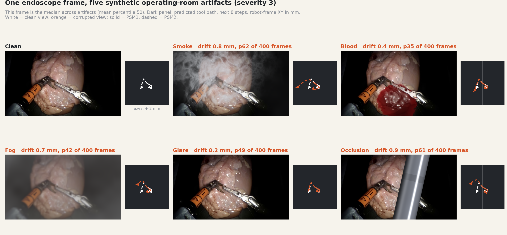

# GR00T-H surgical artifact stress test

This repository measures how much the predicted tool motion of [NVIDIA GR00T-H N1.7](https://github.com/NVIDIA-Medtech/GR00T-H) changes when the endoscope image is degraded by synthetic operating-room artifacts: smoke, blood, lens fog, specular glare and an occluding instrument shaft. Frames come from the JHU dVRK NephFat set in [Open-H-Embodiment](https://huggingface.co/datasets/nvidia/PhysicalAI-Robotics-Open-H-Embodiment) (40 episodes, 10 frames each, 400 frames). Drift is the distance between predictions on the clean and corrupted frame with the same sampling seed. The analysis plan was written before any run (`docs/preregistration.md`). Under that plan every artifact is rated ROBUST: at severity 5 the drift stays below twice the re-seed noise floor. Fully blanking the endoscope view moves the prediction about as much as re-seeding the model, so on this sample the endoscope view has little influence on the 8-step output. Blanking all cameras moves the prediction about twice as much (2.177 mm against a 1.104 mm floor on the 60-frame subset), so the other views do matter.

## Key results

Endoscope view corrupted, severity 3 unless noted. Distances in mm over both arms. 95% CIs are bootstrap over episodes (2000 resamples). R = drift divided by clean-vs-ground-truth error.

| Quantity | 8 steps | 50 steps |
|---|---|---|
| Noise floor (re-seed, clean frame) | 1.096 | 3.428 |
| Clean vs ground truth | 1.418 | 6.132 |
| Hold-state error | 2.020 | 5.614 |

| Artifact | D8 s3 [95% CI] | R8 | D8 s5 | D50 s3 | R50 | D50 s5 | Gripper flip, 8 steps, s3 | Verdict (8 / 50) |
|---|---|---|---|---|---|---|---|---|
| Smoke | 0.828 [0.74, 0.93] | 0.58 | 0.998 | 3.647 | 0.59 | 4.380 | 0.140 | ROBUST / ROBUST |
| Blood | 0.662 [0.58, 0.75] | 0.47 | 0.864 | 2.996 | 0.49 | 3.865 | 0.116 | ROBUST / ROBUST |
| Fog | 0.930 [0.81, 1.06] | 0.66 | 0.991 | 3.362 | 0.55 | 4.237 | 0.135 | ROBUST / ROBUST |
| Glare | 0.266 [0.24, 0.30] | 0.19 | 0.512 | 1.166 | 0.19 | 2.325 | 0.076 | ROBUST / ROBUST |
| Occlusion | 0.907 [0.82, 1.01] | 0.64 | 1.077 | 4.184 | 0.68 | 4.950 | 0.159 | ROBUST / ROBUST |
| Gaussian noise (control) | 0.921 [0.82, 1.02] | 0.65 | 1.089 | 4.054 | 0.66 | 4.835 | 0.166 | ROBUST / ROBUST |
| Brightness (control) | 0.155 [0.14, 0.17] | 0.11 | 0.268 | 0.694 | 0.11 | 1.237 | 0.065 | ROBUST / ROBUST |

Smoke is not surgical-specific under the preregistered test: at severity 3 its drift is not above Gaussian noise at matched MSE (smoke minus Gaussian: -0.092 mm, CI lower bound -0.179). It is above the brightness control (+0.673 mm), but brightness jitter is part of GR00T-H's training augmentation, so low drift there is expected.

Blank-camera diagnostics (60-frame subset, not the 400-frame sample), first 8 steps / 50 steps:

| Condition | Drift 8 steps | Drift 50 steps |
|---|---|---|
| Re-seed noise floor (same 60 frames) | 1.104 | 3.571 |
| Blank endoscope | 0.947 | 4.311 |
| All cameras blank | 2.177 | 7.299 |

On the 400-frame sample, the exploratory vision-use fraction (artifact drift divided by blank-endoscope drift) at 8 steps is 0.90 [0.84, 0.96] for smoke, 0.72 [0.66, 0.77] for blood, 1.00 [0.91, 1.13] for fog, 0.29 [0.26, 0.32] for glare and 0.98 [0.93, 1.04] for occlusion. The fp16 run agrees with an fp32 reference to 0.005 mm (0.25% of clean error). One diagnostic check failed: the 4-seed ensemble clean error at 50 steps (5.767 mm) is not below the hold-state error (5.614 mm). See `results/result_block.txt` for the full output. Its line "NOT SURGICAL-SPECIFIC ... smoke exceeds Gaussian noise and brightness" is a fixed template string; the verdict is the label, and the numbers on the next line show smoke does not exceed Gaussian noise.



`fig_drift_v2.png` and `fig_vision_use.png` are regenerated from `results/summary.json` and `results/blank_ci.json` (blank-camera drift with bootstrap CI, derived from the 60-frame diagnostic) by `python tools/make_figures.py`.

Other figures in `results/figures/`: `fig_drift_v2.png` (drift against severity), `fig_vision_use.png` (blank-camera comparison), `fig_b2_drift_vs_psnr.png`, `fig_c_gripper_flip.png`, `corruption_grid.png`.

## Method

- Model: `nvidia/GR00T-H-N1.7`, fp16 on a T4 (the repository's bf16 cast is replaced because T4 has no bf16), sdpa attention.
- Data: JHU dVRK NephFat, 40 evenly spaced episodes, 10 evenly spaced timesteps each. Only the endoscope view is corrupted in the primary condition. A secondary condition corrupts all views at severities 3 and 5.
- Corruptions, 5 severities each: smoke (atmospheric scattering with a fractal density field), blood (translucent pooled regions), fog (radial blur, contrast loss, haze), glare (specular spots and bloom), occlusion (instrument shaft covering 5 to 40 percent of the frame). Controls: Gaussian noise and brightness shift, matched to smoke in MSE at model-input resolution.
- Drift D is the mean over predicted steps of the per-step Euclidean distance of the translation, summed over both arms, between corrupted and clean predictions with the same seed. The noise floor is the drift between two seeds on the clean frame.
- Verdicts follow `docs/preregistration.md`. Deviations and clarifications are in `docs/deviations.md`.

## How to run

Requirements: a GPU with 16 GB (Kaggle T4 or similar), internet access, and a Hugging Face token with access to the gated `nvidia/Cosmos-Reason2-2B`. Provide the token as the `HF_TOKEN` environment variable or, on Kaggle, as a secret named `HF_TOKEN`. No token is stored in the code. See `.env.example`.

1. Open `notebooks/gr00th_stress.ipynb` on Kaggle with a GPU and internet enabled, add the `HF_TOKEN` secret, and run all cells. The notebook builds the GR00T-H environment, runs a 60-frame diagnostic stage, then the full sweep, analysis and figures.
2. `QUICK = True` in the first code cell selects a reduced sample (6 episodes x 3 frames) written to `outputs_quick`.
3. The CLI in `gr00th_stress.py` exposes the stages (`--stage data,model_check,diag,visual,main,video,analysis,figures,zip,selftest`).

CPU tests (mock dataset and policy, no GPU, no network):

```
pip install -r requirements.txt pytest
pytest -q
```

## Limitations

- The evaluated frames come from a dataset that is part of GR00T-H's training mix. Clean accuracy is optimistic, and the measurement is sensitivity of the output, not generalization.
- The artifacts are synthetic approximations applied to single frames, not real smoke, blood or fog.
- The evaluation is open loop. Drift in predicted motion is not shown to change closed-loop behaviour.
- One dataset and one embodiment (JHU dVRK NephFat) were used. The secondary embodiment was not run.
- The 50-step predictions are no better than holding the current state (hold-state error 5.614 mm against clean error 6.132 mm), so conclusions about long-horizon predictions are weak.
- Blank-camera rows use a 60-frame subset.
- The ROBUST label means drift is below the sampling spread under shared noise. Corrupted frames were not compared across different seeds.

## Repository layout

```
gr00th_stress.py        library and CLI for all stages
notebooks/              Kaggle notebook (outputs cleared)
tests/                  CPU mock harness and pytest entry
tools/                  make_figures.py (rebuilds two README figures)
docs/                   preregistration, deviations
results/                summary.json, summary_table.csv, result_block.txt, diag.json,
                        config.json, fp_check.json, figures/
```

## Citation

See `CITATION.cff`.

## Acknowledgements and licenses

- Code in this repository: Apache-2.0 (`LICENSE`).
- GR00T-H code: Apache-2.0. GR00T-H model weights: NVIDIA Open Model License. The gated backbone `nvidia/Cosmos-Reason2-2B` has its own terms.
- Open-H-Embodiment dataset: CC-BY-4.0, attribution to NVIDIA and the dataset contributors. The figures in `results/figures/` contain frames from this dataset (JHU dVRK NephFat) and are shared under the same attribution requirement.
